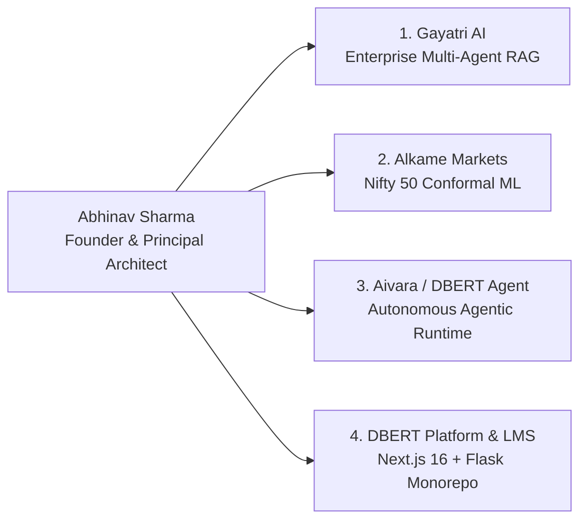

 

 

---

### 👨‍💻 About Me

Hello! I am **Abhinav Sharma**, **Founder, CTO & Principal AI Architect at [DBERT](https://dbert.in)** (Digital Blinc Education Research And Technology).

I specialize in architecting sovereign, production-grade AI systems, enterprise multi-agent swarms, conformal prediction frameworks, and high-concurrency cloud applications. At DBERT, I lead research and engineering sprints at **[DBERT Labs](https://dbert.in/labs)** and supervise intensive engineering incubation cohorts that transition ambitious developers into high-performing pre-vetted engineers.

> 🌐 **Domain Authority Notice**: The official sovereign platform is hosted at **[dbert.in](https://dbert.in)** and **[lms.dbert.in](https://lms.dbert.in)** *(the retired domain `dbert.online` has been officially transitioned to `dbert.in`)*.

---

### 🏛️ DBERT Ecosystem Quick Navigation

| Platform / Hub | Description | Direct Access |
|---|---|:---:|
| **DBERT AI Venture Studio** | Sovereign AI incubation, equity-based venture studio & enterprise solutions | [dbert.in ↗](https://dbert.in) |
| **DBERT LMS & Internship Platform** | Live learning management, technical sprint tasks & career milestones | [lms.dbert.in ↗](https://lms.dbert.in) |
| **Pre-Vetted Engineers Directory** | Cryptographically verified candidate dossiers, Turnitin rubrics & code evaluations | [dbert.in/verify/directory ↗](https://dbert.in/verify/directory) |
| **Engineering Leadership Registry** | Practitioners, domain mentors & production project contributors | [dbert.in/about/team ↗](https://dbert.in/about/team) |
| **Open Source Repositories & Weights** | Public codebases, Ollama edge models & multi-agent frameworks | [dbert.in/labs/opensource ↗](https://dbert.in/labs/opensource) |
| **Credential Verification Gateway** | Instant cryptographic verification of official DBERT credentials | [dbert.in/verify ↗](https://dbert.in/verify) |
| **Capstone & PR Evaluation Portal** | Production Pull Request submission rubric & ₹5,000 stipend release engine | [lms.dbert.in/stipend/tasks ↗](https://lms.dbert.in/stipend/tasks) |
| **Incubation Enrollment & Balance** | 2-month sovereign incubation program & verified credential unlock | [dbert.in/enroll/1999 ↗](https://dbert.in/enroll/1999) |

---

### 🚀 Flagship Production Repositories & Architecture

I architect, maintain, and supervise contributions across our 4 flagship production repositories:

#### 1. [Gayatri AI](https://github.com/Gayatri-Education/Gayatri-Demo) &bull; [ainabhinavsharma/Gayatri-AI](https://github.com/ainabhinavsharma/Gayatri-AI)
- **Domain**: Applied AI, Cognitive Graphs & Enterprise Pedagogical RAG
- **Architecture**: Multi-agent cognitive intelligence platform featuring localized vector knowledge bases, retrieval-augmented pedagogical guidance, and automated assessment parsing pipelines.
- **Stack**: Python, PyTorch, LangChain, FastAPI, Next.js, PostgreSQL.

#### 2. [Alkame Markets (Nifty 50 Educational Predictor)](https://github.com/Alkameinc/alkame-nifty-50-educational) &bull; [ainabhinavsharma/alkame-nifty-50-educational](https://github.com/ainabhinavsharma/alkame-nifty-50-educational)
- **Domain**: Quantitative Finance, Machine Learning & Conformal Prediction
- **Architecture**: Algorithmic market forecasting engine with walk-forward validation gates, inductive conformal prediction intervals under covariate shift, and automated backtesting frameworks.
- **Stack**: Python, Scikit-learn, XGBoost, Pandas, FastAPI, Streamlit.

#### 3. [Aivara Autonomous Suite / DBERT Agent](https://github.com/DBERT-INDIA/dbert-agent) &bull; [ainabhinavsharma/vayanai](https://github.com/ainabhinavsharma/vayanai)
- **Domain**: Autonomous LLM Agents & Edge Execution
- **Architecture**: Production-grade multi-agent runtime featuring dynamic tool calling, memory virtualization, local Ollama model orchestration, and structured JSON output guarantees.
- **Stack**: Python, LangGraph, Ollama, Docker, Redis, Celery.

#### 4. [DBERT Website & LMS Engine](https://github.com/DBERT-INDIA/dbert-website-lms) &bull; [ainabhinavsharma/DBERT-LMS](https://github.com/ainabhinavsharma/DBERT-LMS)
- **Domain**: High-Concurrency Distributed Platforms & Cryptographic Verification
- **Architecture**: Dual-stack monorepo uniting Next.js 16 App Router (Turbopack standalone SSG/SSR) with Python Flask Gunicorn & PostgreSQL. Implements cryptographic credential signing, turnitin originality audits, and zero-downtime EC2 deployments.
- **Stack**: Next.js 16, TypeScript, Python Flask, Gunicorn, PostgreSQL, Nginx, AWS EC2.

---

### 🛡️ Verified Talent & Mentorship Ecosystem

At **[DBERT.in](https://dbert.in)**, our mission is to eliminate unverified resumes by training and certifying engineers on real production codebases:
- **465+ Fellows Mentored** across Generative AI, Full-Stack Engineering, Python Automation, and Data Analytics.
- **Strict Production Gateways**: Stipends and credentials require authenticated Pull Requests on official repositories and Turnitin plagiarism screening.
- **Public Talent Directory**: Recruiters and engineering leaders can inspect verified code dossiers and evaluation scores directly at **[dbert.in/verify/directory](https://dbert.in/verify/directory)**.

&nbsp;&nbsp;

&nbsp;&nbsp;

---

### 🛠️ Technical Arsenal & Core Competencies

**🤖 Artificial Intelligence, LLMs & Multi-Agent Swarms**

`LangChain` &bull; `LangGraph` &bull; `LlamaIndex` &bull; `Ollama` &bull; `HuggingFace` &bull; `RAG Architectures` &bull; `Conformal Prediction` &bull; `Vector DBs (Chroma/FAISS)`

 

**⚙️ Distributed Backend, Cloud & Data Infrastructure**

`PostgreSQL` &bull; `Redis` &bull; `Celery` &bull; `AWS EC2/S3` &bull; `Nginx Reverse Proxy` &bull; `Systemd Daemons` &bull; `REST & GraphQL APIs`

 

**🎨 Modern Web Engineering & Frontend Architecture**

`Next.js 16 App Router` &bull; `Turbopack` &bull; `Server Components (RSC)` &bull; `Schema.org JSON-LD` &bull; `Technical SEO`

---

### 📊 GitHub Analytics & Realtime Telemetry

 

---

### 🤝 Connect & Collaborate

&nbsp;&nbsp;

&nbsp;&nbsp;

&nbsp;&nbsp;

&nbsp;&nbsp;

  

*"Great engineering is not merely about writing code; it is about architecting sovereign systems and empowering developers to build with mathematical rigor."*

**— Abhinav Sharma**

